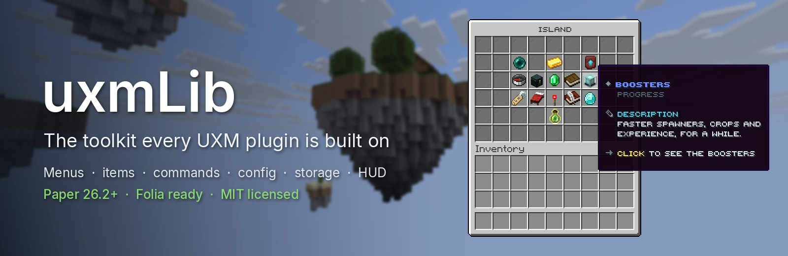

<p align="center">
  
</p>

<p align="center">
  <a href="https://repo.uxplima.com/repository/maven-public/com/uxplima/uxmlib/uxmlib-all/"></a>
  <a href="https://github.com/UXPLIMA/uxm-lib/actions/workflows/ci.yml"></a>
  
  <a href="LICENSE"></a>
</p>

**uxmLib** is a modular toolkit for **Paper 26.2+** plugins and the base of every UXM plugin: inventory menus and
menus defined in files, items, Brigadier commands, typed config, pooled storage, leaderboards, holograms, HUD
overlays, Bedrock forms, soft-dependency integrations and a config-driven condition and action engine. Take only
the modules you need. It is Folia-ready and emits Java 21 bytecode.

**[Manual](https://docs.uxplima.com/minecraft/libraries/uxmlib)** ·
**[Modules](#modules)** ·
**[Report a bug](https://github.com/UXPLIMA/uxm-lib/issues)**

## What it gives you

### Menus in code or in files

The window in the banner is a uxmLib menu. Build one in a few lines, or let the menu engine read it from a HOCON
file an operator owns, with paged lists, click actions, conditions and a native form for Bedrock players.

```java
SimpleGui menu = Guis.gui().title(Text.mini("<dark_aqua>Menu")).rows(3).build();
menu.filler().fillBorder(GuiItem.display(pane));        // border / row / column / rect / fill helpers
menu.set(2, 5, GuiItem.button(icon, e -> click()));     // 1-indexed row, col
menu.open(player);
```

### Commands that answer in your words

An annotation DSL or the Brigadier tree itself. A player who may not use a word reads your message, never
Brigadier's "Incorrect argument".

```java
@Command(name = "money", description = "Manage balances")
class MoneyCommand {

    @Subcommand("pay")
    @Permission("money.pay")
    void pay(Sender sender, @Arg("target") String target, @Arg(value = "amount", min = 1) int amount) {
        sender.send(Text.mini("<green>Paid " + amount + " to " + target));
    }
}
```

### Config, storage and languages

Typed HOCON config with hot reload, a MiniMessage message catalogue in every language, and plain JDBC on SQLite,
MySQL, MariaDB or PostgreSQL with migrations and caches. `@EveryBackend` runs a storage test on all four.

### What players see

Holograms on native Display entities, a flicker-free sidebar, boss bars, titles, tab list and name tags, and
leaderboards in every period with ready placeholders.

## Install

```kotlin
repositories {
    mavenCentral()
    maven("https://repo.papermc.io/repository/maven-public/")
    maven("https://repo.uxplima.com/repository/maven-public/")
}

dependencies {
    implementation(platform("com.uxplima.uxmlib:uxmlib-bom:VERSION"))
    implementation("com.uxplima.uxmlib:uxmlib-gui")
    implementation("com.uxplima.uxmlib:uxmlib-command")
}
```

`VERSION` is the latest release on the badge above. Maven, the standalone server jar and relocation are in
[docs/user/installation.md](docs/user/installation.md).

## Modules

Every module is published on its own under `com.uxplima.uxmlib`. The experimental ones may change in any
release.

| Module | What it gives you |
| --- | --- |
| `uxmlib-common` | The shared foundation: a Folia-ready `Scheduler`, MiniMessage `Text`, a config-driven style layer (`Theme`/`Styler`/`Typography`/`StyleTokens`), node-based `HoconConfig` and typed-record `RecordConfig` with hot reload and live `ConfigProperty`, a MiniMessage-native i18n message catalog, a ReDoS-guarded `TimedRegex`, a `BackupParticipants` seam that lets a plugin flush its state before something copies its files, type-safe particle spawning, and `Durations`/`Numbers`/`Sounds`/`SemanticVersion`/`ServerVersion` helpers. |
| `uxmlib-item` | A fluent `ItemBuilder` (name, lore, enchantments, attributes, flags, durability, banners, components, with removers), sealed `SkullData` player heads with an async skin resolver, registry lookups for the key-based enchantments and attributes, component-safe and gzip serialization, single-key `isSimilar`, and typed persistent-data helpers. |
| `uxmlib-gui` | An inventory-menu framework: simple / paginated / scrolling / storage / typed (hopper, dispenser, …) menus; static, animated, dynamic, and per-viewer stateful items; border/row/column/rect fillers; interaction control; multi-screen navigation; menus defined in HOCON; unified anvil/chat/sign text input; the tile/lore/title/sound side of the style layer; and a facade over Paper's server-side Dialogs. |
| `uxmlib-bedrock` | Native Bedrock forms for a server that lets Bedrock clients in through Geyser or Floodgate: a `BedrockDetector` that answers whether a viewer is a Bedrock player, and a `BedrockScreen` that sends them a simple, modal, input, or custom form. The vocabulary a caller builds a form out of (`BedrockButton`, `BedrockWidget`, `BedrockImage`, `BedrockIcons`) names no SDK type, so a form is built and tested with nothing on the classpath. Each interface has a `NONE` constant and a `forServer` factory, so a Java-only server loads no Geyser or Floodgate class at all and a caller never guards the call itself. |
| `uxmlib-menu` | The data-driven menu engine: a menu is a file, and this module reads one and runs it. A HOCON spec parses into an immutable, platform-free model, which a renderer draws and a runtime clicks through. It carries paged and scrolling lists with a query and a sort, a requirement and an action on each of the four click sides, an expression language for slots and computed numbers, a property editor (text, number, toggle, enum, colour, list) over the unified text input, confirm and selector windows, and an icon provider registry that reads a head, a serialized stack, or an item from ItemsAdder, Oraxen, Nexo, CraftEngine, MMOItems, ExecutableItems, HeadDatabase and EntryStack past a plugin-present guard. A Bedrock viewer is handed the same menu as a native form. It names no colour and no wording of its own: a consumer registers what its menus may say and do through `MenuBindings`. |
| `uxmlib-command` | A thin facade over Paper's Brigadier (`Cmd`/`Args`/`Sender`/`CommandRegistrar`) **and** an annotation DSL on top of it: `@Command`/`@Subcommand`/`@Arg`, permissions, `@Range`/`@Length`, `@Cooldown`, flags and switches, async execution, help pagination, and resolver/validator/condition SPIs. |
| `uxmlib-storage` | Plain-JDBC persistence: a HikariCP-pooled `Database` opened from a named backend (SQLite, MySQL, MariaDB, PostgreSQL; H2 opt-in), an injection-safe `SelectBuilder`, parameterised `Sql`/`TxSql`, versioned migrations, a Caffeine-backed write-through / write-behind cache, a two-tier player-profile cache, and cross-server row sync. |
| `uxmlib-storage-testing` | A test dependency: `@EveryBackend` runs a storage test on SQLite and on MySQL, MariaDB and PostgreSQL in containers. |
| `uxmlib-board` | Leaderboards in the grammar every UXM plugin shares: counters, records and snapshot boards in every period (all time, monthly, weekly, daily), kept in the plugin's own SQL database with atomic adds, read on a timer into memory, and answered as `top_<board>_<period>_<n>_name\|value\|head`, `rank_…`, `value_…` and `resets_…` placeholders. |
| `uxmlib-network` | Messages between the servers of a network with no server type in sight: a `Bus` carries frames by topic, over a direct broker a proxy plugin runs (no player online needed, no other service) or over Redis pub/sub. |
| `uxmlib-redis` | A low-level binary (`byte[]`) Redis pub/sub bus for fanning an opaque frame across the server nodes sharing one Redis (fail-degraded publish, per-subscription auto-reconnect), with no relational dependencies (Lettuce is a compile-only soft-dependency). |
| `uxmlib-integration` | Soft-dependency hooks reached only past a present-guard: PlaceholderAPI (read **and** expansion registration), Vault and VaultUnlocked economy, Vault permissions, LuckPerms, WorldGuard/Towny region queries, a transient advancement-toast API, an online-data lifecycle manager, a dependency-free Discord webhook, and native-`Display` [holograms](#holograms). |
| `uxmlib-hud` | Adventure-native HUD overlays, all through the public player API: a flicker-free diffing sidebar, title/subtitle, a sticky action bar, boss bars with a mode enum (permanent/filling/countdown/dynamic), tablist header/footer, per-tick text animators, and a nametag registry that composes several plugins' prefixes, suffixes and colours onto the one team a player may belong to. |
| `uxmlib-update` | A notify-only release update checker (GitHub / Modrinth providers) that compares a build-time version constant against the latest release and surfaces a permission-gated clickable join message. It never self-downloads. |
| `uxmlib-condition` | A declarative condition engine (operand comparison + placeholder resolution + failure policy) and its natural pair, a config-driven action engine (`[message]`, `[console]`, `[title]`, … parsed once into closures). Its `Wallet` seam reads, takes and pays, and ships soft backends for Vault, VaultUnlocked, PlayerPoints, EcoBits, Treasury, and any economy reachable by a placeholder and a console line, plus the player's own experience counted in points or in levels. |
| `uxmlib-pipeline` | **Experimental.** A from-scratch, MIT-clean Netty pipeline: channel resolve, idempotent inject/eject, a self-healing reorder watchdog, and a fail-open listener seam. It builds no packet and knows no entity. Alone in the packet family it needs no Mojang-mapped server, so a plugin that wants a pipeline and no server internals can take it on its own. |
| `uxmlib-packet` | **Experimental.** The shared Mojang-mapped packet helpers (Adventure→vanilla component conversion, bundling, the stream-codec buffer trick, guarded reflection, entity-id allocation) plus per-viewer tab-list, NPC, text-display, and inventory-item packet ports built on them. |
| `uxmlib-nametags` | **Experimental.** A from-scratch per-viewer nametag renderer (different prefixes/colours/visibility per viewer) over scoreboard-team and metadata packets, without touching the server-side scoreboard. |
| `uxmlib-schematic` | Structure files with no WorldEdit and no FAWE on the server: a bounded tag reader and writer, Sponge schematics of versions 1, 2 and 3 read and version 3 written, a paste that loads each chunk without waiting and works it a slice a tick on the thread that owns it (turned in quarter turns, block entities, entities and biomes carried, a report of what could not be placed as saved), and a capture that saves a box of a world as a schematic. Names an older version wrote are read as that version meant them. |
| `uxmlib-bom` | A bill of materials so a consumer can align every `uxmlib-*` artifact to one version with a single platform import. |
| `uxmlib-all` | The aggregate of every module on the API surface. The same module also builds the standalone server-side plugin jar, published beside it under the `standalone` classifier. |

## Documentation

- [docs/user](docs/README.md): installing and using each module.
- [docs/internals/overview.md](docs/internals/overview.md): the module graph and the rules behind it.
- [docs/operations/development.md](docs/operations/development.md): building, trying and releasing.

## License

[MIT](LICENSE). No code is copied from GPL, AGPL or proprietary sources.
