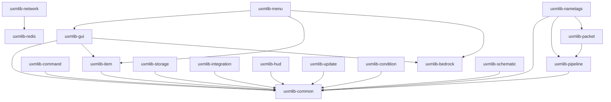

# Overview

uxmLib is a set of Gradle modules under one root, each published as its own artifact. `uxmlib-bom` aligns
their versions and `uxmlib-all` aggregates them and builds the standalone server jar.

## Module graph

An arrow points at a dependency. Nothing depends upward: `uxmlib-common` depends on no other module, and
the graph has no cycle.

## Rules every module keeps

- **One server line.** Every API targets the current Paper line. There is no reflection layer and no
  adapter for older servers; a server internal that moves fails the build, not a server.
- **Folia-ready.** Nothing schedules through `BukkitScheduler`. Work goes through `Scheduler`, which maps
  onto Paper's global, region, entity and async schedulers.
- **Adventure only.** All text is Adventure components built from MiniMessage. Legacy colour codes are
  not supported.
- **Null-marked.** Every package is JSpecify `@NullMarked`; NullAway and Error Prone run as errors through
  `uxm.library`.
- **Plain objects.** Constructor injection and no static mutable state. The only `JavaPlugin` is the shell
  in `uxmlib-all`.
- **Soft dependencies stay soft.** An integration is `compileOnly` and is reached only past a check that
  its plugin is present, so a server without it loads none of its classes.
- **Infrastructure, not competitors.** Only neutral libraries are dependencies: HikariCP, Caffeine,
  Configurate, Lettuce. The Minecraft-facing API is written here, clean-room, and nothing is copied from a
  GPL, AGPL or proprietary source.
- **Server internals are quarantined.** Only `uxmlib-packet` and `uxmlib-nametags` compile against the
  Mojang-mapped server, through paperweight, and only in named classes behind plain interfaces.

## Bytecode and toolchain

The modules emit Java 21 bytecode and compile with a Java 25 toolchain, because the Paper API ships Java 25
class files. A server runs Java 25 and reads Java 21 class files, and the modules that never touch a server
(config, storage, Redis) can be used from an ordinary Java 21 project.

## Versioning

Releases follow semantic versioning from `0.0.1`, cut by release-please. While the version is below
`1.0.0` a minor release may change an API. The experimental modules (`uxmlib-pipeline`, `uxmlib-packet`,
`uxmlib-nametags`) may change in any release.
